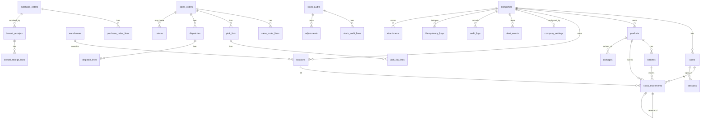

# Architecture

```
Browser (phones, tablets, desktops)
   │  HTTPS (Railway edge)
   ▼
Next.js 15 app (Railway service "BT-WMS")
   ├─ middleware.ts        request id, login redirect, API rate limit, CSRF origin check
   ├─ app/(app)/*          server-rendered pages (React Server Components)
   ├─ app/**/actions.ts    server actions, each wrapped in action(permission, …)
   ├─ app/api/*            JSON / PDF / Excel routes, each wrapped in apiRoute(permission, …)
   ├─ instrumentation.ts   in-app scheduler for the daily digest
   └─ src/server
        ├─ auth/           sessions (httpOnly cookie, SHA-256 token in DB), bcrypt, lockout, permission map
        ├─ db/client.ts    ONE Prisma client, pool limits, retry with backoff, pool reset after a drop
        ├─ db/tenant.ts    tenant-scoped client: every query forced onto the user's company
        ├─ stock.ts        the only writer of stock_movements (inside transactions)
        ├─ ops/*           business operations (inward, outward, internal, masters, settings)
        ├─ reports.ts      13 reports as plain data → table / Excel / PDF
        ├─ alerts.ts       alert rules, once-only alert events, digest + notifier adapter
        └─ labels.ts       barcode / QR label PDFs
   │  Prisma (private network)
   ▼
PostgreSQL 17 (Railway service "Postgres", volume-backed)
   ├─ append-only stock_movements (UPDATE/DELETE/TRUNCATE blocked by trigger)
   ├─ no-negative-stock trigger with per (product, tile, batch) advisory lock
   ├─ stock_balance view = SUM(direction × quantity)
   └─ composite (id, company_id) foreign keys: a row can never point at another company's data
```

## Request path of a write (e.g. dispatch)

1. Button press → server action `dispatchAction` → `action("dispatch.manage", …)` checks session + permission.
2. `dispatchOrder()` runs inside `once()`: one transaction, guarded by the form's idempotency key.
3. `lockKeys()` takes an advisory lock for the order, so two dispatches of the same order run one after the other.
4. `postMovements()` inserts OUTWARD rows + audit rows; the DB trigger refuses anything that would go negative.
5. Commit, `router.refresh()` re-renders the page from the ledger.

## Database diagram



`stock_balance` is a view over `stock_movements` (not a table). Every business table carries
`company_id` and `warehouse_id`. Full column list: `prisma/schema.prisma`.

## Performance notes (EXPLAIN reviewed)

Heaviest queries and the index each uses:

| Query                                                          | Index                                                             |
| -------------------------------------------------------------- | ----------------------------------------------------------------- |
| Balance for one product/tile/batch (trigger + pick allocation) | `stock_movements (company_id, product_id, location_id, batch_id)` |
| Dashboard trend, ledger by period                              | `stock_movements (company_id, created_at)`                        |
| "What is on this tile" / ledger by tile                        | `stock_movements (company_id, location_id)`                       |
| Lookups by document                                            | `stock_movements (reference_type, reference_id)`                  |
| Expiry scans                                                   | `batches (company_id, expiry_date)`                               |
| Order lists by status                                          | `sales_orders / purchase_orders (company_id, status)`             |

Run `node scripts/explain.mjs` against a database to print the plans. At today's size (85 SKUs,
~100 tiles) every query plans under 5 ms; the view aggregates per company, so the
ceiling is millions of movements per company before a materialised balance table is worth adding.
